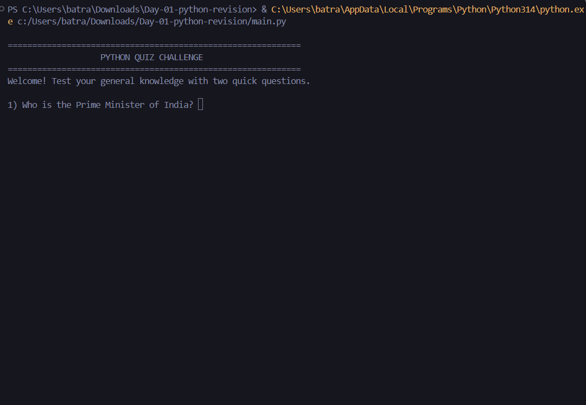
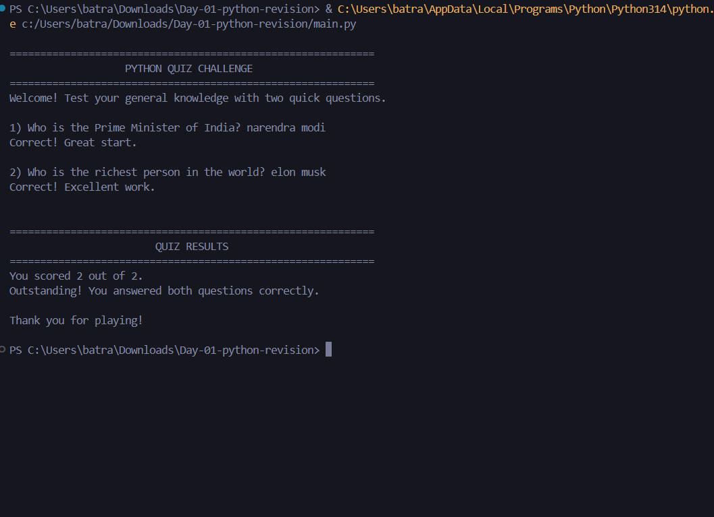

<div align="center">

# Python Core Revision

### A small command-line quiz demonstrating Python fundamentals

Two fixed general-knowledge questions, immediate answer feedback, and a final score — built as a practical Python revision exercise.

[](https://www.python.org/)
[](#technologies)
[](#)

</div>

---

## Overview

Python Core Revision is a beginner-friendly terminal quiz created to put core Python syntax into practice. When run, it displays a welcome banner, prompts the player to answer two questions, checks each response, and reports a score out of two with a short result message.

The answers are built into the program. Input matching ignores capitalization and leading or trailing whitespace; the quiz does not fetch or verify live information.

## Features

- Two sequential, fixed quiz questions.
- Case-insensitive answer matching with surrounding whitespace ignored.
- Immediate feedback after each response, including the expected answer when incorrect.
- Score tracking and a final result message.
- Text-based banners for the welcome screen and results.

## Screenshots

<table width="100%">
  <tr>
    <td align="center" width="50%"><strong>Question prompt</strong></td>
    <td align="center" width="50%"><strong>Completed quiz</strong></td>
  </tr>
  <tr>
    <td align="center" width="50%"></td>
    <td align="center" width="50%"></td>
  </tr>
</table>

## Technologies

- **Python 3.6 or newer** — the program uses f-strings, introduced in Python 3.6.
- **Python standard library only** — no third-party packages or installation steps are required.
- **Command-line input and output** — interaction uses the built-in `input()` and `print()` functions.

## Concepts practised

- Reading interactive input with `input()`.
- Normalizing strings with `strip()` and `lower()` before comparing answers.
- Using `if` / `else` conditionals to check answers and select feedback.
- Initializing and updating a score variable.
- Defining and calling a function to print a centered text banner.
- Formatting output with f-strings.

## Installation and usage

### Prerequisites

- Python 3.6 or newer available on your `PATH`.
- Git, to clone the repository.

### Run the quiz

```bash
git clone https://github.com/chetanaybuilder/Ai-Ml-Month-01-Math-Python.git
cd Ai-Ml-Month-01-Math-Python/Day-01-Python-Revision-Project
python main.py
```

On Windows, if `python` is not the Python launcher on your `PATH`, you can run the final command with `py main.py`.

Type an answer at each prompt and press Enter. The program accepts answers regardless of letter case and ignores spaces at the beginning or end. After the second response, it displays the score and exits.

## Project structure

```text
Day-01-Python-Revision-Project/
├── .gitignore
├── README.md
├── main.py
└── assets/
    ├── quiz-question.png
    └── quiz-results.png
```

## Learning outcomes

This exercise brings together basic input handling, string normalization, conditional branching, variable updates, and formatted terminal output in one small runnable program. It also provides practice organizing a project with documentation and screenshot assets.

## Possible next steps

These are ideas for future iterations; they are not part of the current quiz:

- Move questions and answers into a reusable question list.
- Add a replay option or a configurable question set.
- Add automated tests for answer checking and score calculation.

---

<div align="center">

Created by [chetanaybuilder](https://github.com/chetanaybuilder)

</div>
